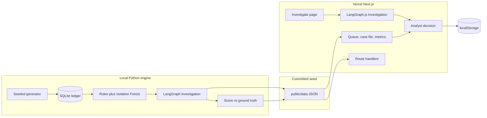
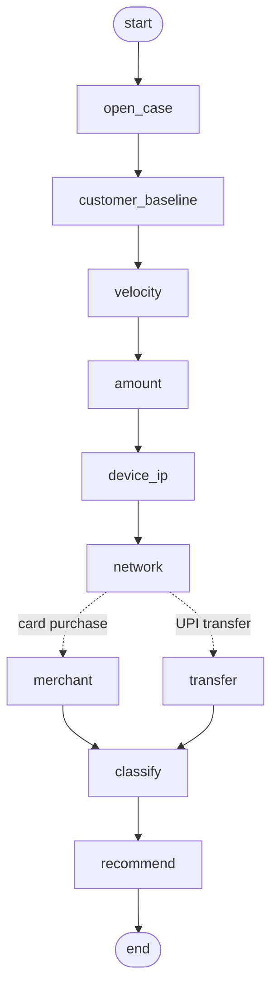

# FraudLens

Live desk: [https://fraudlens-desk.vercel.app](https://fraudlens-desk.vercel.app)

The Vercel project is named `fraudlens`. `fraudlens.vercel.app` is already taken by another team, so the public address is `fraudlens-desk.vercel.app`. The previous address, [halden-fraud-agent-demo.vercel.app](https://halden-fraud-agent-demo.vercel.app), still opens this same desk.

FraudLens is a fraud investigation desk for an Indian payments book. A payment is flagged, an agent reads the file the way an analyst would, and a person decides whether to approve, hold, escalate, or block. The agent never takes the action itself.

It runs on a seeded synthetic book of Indian customers, cards, and UPI transfers, in rupees (₹). The fraud is card testing, account takeover, mule-account chains, and merchant collusion. Alongside it are honest customers who look suspicious: a real trip abroad, a one-off electronics purchase, a flash sale, a new phone at home, and a shared household device. No API key.

On seed 42 the blunt queue catches **98 of 98** fraud payments, raises **19** false alarms, and would block **8 genuine customers**. FraudLens also catches **98 of 98**, raises **1** false alarm (precision 98.99%), and would block **0** genuine customers. The false alarm is a legitimate ₹798.30 bookshop purchase that fell inside the time window of a mule-chain case on the same account. It is reported as it came out. The same checks on seeds 7, 99, and 123 are on the metrics page and in `REPORT.md`.

## Run it locally

```bash
pip install -r requirements.txt
python -m engine.build
npm install
npm run dev
```

Open http://127.0.0.1:43123.

`python -m engine.build` rewrites `data/fraudlens.db`, `data/seed/`, and `public/data/`. The committed JSON is already generated with seed `42`, so you can skip the Python steps and just run:

```bash
npm install
npm run dev
```

Tests:

```bash
python -m pytest tests -q
npm test
```

`npm test` runs the in-browser investigator without starting the server. The same seed repeats. Across 200 seeds of each scenario it has to name the planted pattern, recommend block or escalate for fraud, and approve a genuine trip. One thousand further seeds must not crash. The same checks are replayed on the 30 precomputed cases and compared with the Python agent.

## Deploy to Vercel

The demo is a Next.js app. Investigations are precomputed, so the deployment does not run pandas, NetworkX, scikit-learn, or the Python LangGraph, and it does not need a database or an API key.

1. Import the repository into Vercel.
2. **Framework preset: Next.js.** If auto-detect picks Python because `requirements.txt` is in the repo, change the preset to Next.js before you deploy. The Python file is only for regenerating the ledger locally.
3. Root directory: the repository root.
4. Build command: `npm run build` (or leave the default `next build`).
5. Install command: `npm install`.
6. Output: Next.js default. Do not set an environment variable. `OPENAI_API_KEY` and `ANTHROPIC_API_KEY` are optional and unused; the narrative is templated either way.
7. Deploy.

The queue, case files, and metrics are static files under `public/data/`, so the pages work even if a function cold-starts. Route handlers under `app/api/` serve the same JSON. Analyst decisions are stored in the browser (`localStorage`) and, when the function can write, appended under `/tmp`. A production desk would use a real database. `/tmp` on Vercel is ephemeral and not shared across instances.

## What to click

- **Review queue** is the morning review. The five tiles at the top are the pitch. **Investigate a new payment live** opens a live file.
- **Investigate live** (`/investigate`) builds a fresh flagged payment in the browser from a seed you can replay (`/investigate?scenario=card_testing&seed=1234`). Choose card testing, account takeover, a mule chain, merchant collusion, a genuine trip, or random. The browser runs the same LangGraph investigation as the Python desk — history, velocity, amount, device, money flow, merchant — and does not receive the planted label. Steps appear one by one, then the score, the pattern, and a suggested action. Record approve, hold, escalate, or block the same way as on a queued case. The planted scenario is shown only after that decision. Nothing here calls Python or an API key, so it runs on Vercel Hobby.
- **Guided demo** walks card testing, account takeover, a mule chain, merchant collusion, then a genuine trip the queue got wrong.
- Open a case to read the evidence, the step timeline, the linked-entity graph, and the suggested action. Record a decision. The button does not block anyone.
- **Results** is the scorecard against held-out labels: frauds caught, precision, false alarms, genuine customers each approach would have blocked, and the same checks on three other seeds.
- Download a case as Markdown from the case file, or the book-level report from **Results** (`/api/report`).

Amounts are shown in rupees with Indian digit grouping (₹1,23,456.78). Times are shown in IST. Stored timestamps are UTC.

## Architecture



Ground truth lives in `ground_truth` (SQLite) and `data/seed/judge.json`. The agent module only receives `public_world()`: customers, accounts, cards, devices, IPs, merchants, transactions, and device enrollments. Labels are joined after the investigation, for the scorecard.

### The investigation graph

The investigator is a [LangGraph](https://github.com/langchain-ai/langgraph) `StateGraph` with no model call. Each analyst step is a node. A node appends one timestamped finding to the timeline and merges its facts into the shared state. After the money-flow node, the graph routes card purchases to the merchant check and transfers to the transfer check. NetworkX does the money-flow math inside the network node. If a model key is present, `polish_narrative` is the hook for a prose pass; this build does not call out, so a demo cannot fail on a vendor.



`python -c "from engine.agent import graph_mermaid; print(graph_mermaid())"` prints the same graph from the compiled LangGraph.

The live page does not read the precomputed cases. `lib/live` builds one flagged payment and the history around it from a numeric seed, then runs the same nodes on LangGraph.js (`@langchain/langgraph/web`). That engine loads as a separate chunk, so the page shell stays light. The function that decides never receives the scenario name. The page keeps that name beside the result and shows it only after the analyst records a decision.

## Data assumptions

See [DATA_ASSUMPTIONS.md](DATA_ASSUMPTIONS.md). Short version: one currency (INR, stored as paise), customers in Indian cities, documentation-range IP addresses, devices enrolled on the customer profile, and fraud planted on top of ordinary card and UPI traffic. The flagger is deliberately wide. FraudLens's job is to put the honest customers back.

## Scorecard (seed 42)

| | Frauds caught | Precision | False alarms | Genuine customers blocked |
| --- | --- | --- | --- | --- |
| Rubber-stamp the queue | 98 / 98 | 83.76% | 19 payments | 8 |
| Follow FraudLens | 98 / 98 | 98.99% | 1 payment | 0 |

5,459 payments, 181 customers, 98 fraud payments, 30 cases. All four patterns are named correctly on every fraud case. All 8 legitimate cases are approved. Detail is in [REPORT.md](REPORT.md). Talking points for a 3–5 minute pitch are in [DEMO_SCRIPT.md](DEMO_SCRIPT.md).

## Layout

| Path | Role |
| --- | --- |
| `engine/generate.py` | Seeded Indian customers, payments, planted fraud, honest traps |
| `engine/flagging.py` | Rules and an Isolation Forest queue |
| `engine/agent.py` | LangGraph investigation |
| `lib/live/` | The same graph on LangGraph.js, plus a one-case generator, running in the browser |
| `app/investigate/` | Live investigation page |
| `engine/metrics.py` | Frauds caught, precision, false alarms, customer harm |
| `engine/build.py` | Writes SQLite and the JSON the app serves |
| `app/` | Next.js desk |
| `public/data/` | Precomputed cases, copied from `data/seed/` |
| `tests/test_pipeline.py` | Generator, separation of labels, the graph, and the scorecard |
