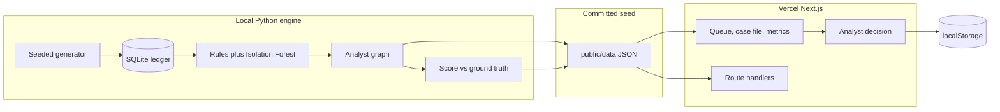

# Halden

Halden is a fraud investigation desk. A payment is flagged, an agent reads the file the way an analyst would, and a person decides whether to approve, hold, escalate, or block. The agent never takes the action itself.

It runs on a seeded synthetic book: card testing, account takeover, mule-account chains, merchant collusion, and honest customers who look suspicious (a real trip, a one-off electronics purchase, a lunch-hour sale, a new phone at home, a shared household iPad). No API key.

On this seed the blunt queue catches **100%** of fraud payments and would also block **8 genuine customers**. Halden still catches **100%**, at **100% precision**, and would block **0** genuine customers.

## Run it locally

```bash
pip install -r requirements.txt
python -m engine.build
npm install
npm run dev
```

Open http://127.0.0.1:43123.

`python -m engine.build` rewrites `data/halden.db`, `data/seed/`, and `public/data/`. The committed JSON is already generated with seed `42`, so you can skip the Python steps and just run:

```bash
npm install
npm run dev
```

Tests:

```bash
python -m pytest tests -q
```

## Deploy to Vercel

The demo is a Next.js app. Investigations are precomputed, so the deployment does not run pandas, NetworkX, or scikit-learn, and it does not need a database or an API key.

1. Import the repository into Vercel.
2. **Framework preset: Next.js.** If auto-detect picks Python because `requirements.txt` is in the repo, change the preset to Next.js before you deploy. The Python file is only for regenerating the ledger locally.
3. Root directory: the repository root.
4. Build command: `npm run build` (or leave the default `next build`).
5. Install command: `npm install`.
6. Output: Next.js default. Do not set an environment variable. `OPENAI_API_KEY` and `ANTHROPIC_API_KEY` are optional and unused; the narrative is templated either way.
7. Deploy.

The queue, case files, and metrics are static files under `public/data/`, so the pages work even if a function cold-starts. Route handlers under `app/api/` serve the same JSON. Analyst decisions are stored in the browser (`localStorage`) and, when the function can write, appended under `/tmp`. A production desk would use a real database. `/tmp` on Vercel is ephemeral and not shared across instances.

## What to click

- **Queue** is the morning review. The five tiles at the top are the pitch.
- **Demo** walks card testing, account takeover, a mule chain, merchant collusion, then a genuine trip the queue got wrong.
- Open a case to read the evidence, the step timeline, the linked-entity graph, and the suggested action. Record a decision. The button does not block anyone.
- **Metrics** is the scorecard against held-out labels: recall, precision, false alarms, and genuine customers each approach would have blocked.
- Download a case as Markdown from the case file, or the book-level report from **Metrics** (`/api/report`).

## Architecture



Ground truth lives in `ground_truth` (SQLite) and `data/seed/judge.json`. The agent module only receives `public_world()`: customers, accounts, cards, devices, IPs, merchants, transactions, and device enrollments. Labels are joined after the investigation, for the scorecard.

The investigator is a fixed graph of steps, in the shape of a LangGraph flow without a model call: open the case, baseline, velocity, amount, device and IP, NetworkX money-flow, merchant, classify, recommend. Each step writes a timestamped finding. If a model key is present, `polish_narrative` is the hook for a prose pass; this build does not call out, so a demo cannot fail on a vendor.

## Data assumptions

See [DATA_ASSUMPTIONS.md](DATA_ASSUMPTIONS.md). Short version: one currency (USD), documentation-range IP addresses, devices enrolled on the customer profile, and fraud planted on top of ordinary card spend. The flagger is deliberately wide. Halden's job is to put the honest customers back.

## Scorecard (seed 42)

| | Recall | Precision | False alarms | Genuine customers blocked |
| --- | --- | --- | --- | --- |
| Rubber-stamp the queue | 100% | 83.8% | 19 payments | 8 |
| Follow Halden | 100% | 100% | 0 | 0 |

5,346 payments, 181 customers, 98 fraud payments, 30 cases. All four patterns are named correctly on every fraud case. All 8 legitimate cases are approved. Detail is in [REPORT.md](REPORT.md). Talking points for a 3–5 minute pitch are in [DEMO_SCRIPT.md](DEMO_SCRIPT.md).

## Layout

| Path | Role |
| --- | --- |
| `engine/generate.py` | Seeded customers, payments, planted fraud, honest traps |
| `engine/flagging.py` | Rules and an Isolation Forest queue |
| `engine/agent.py` | Deterministic investigation |
| `engine/metrics.py` | Recall, precision, false alarms, customer harm |
| `engine/build.py` | Writes SQLite and the JSON the app serves |
| `app/` | Next.js desk |
| `public/data/` | Precomputed cases, copied from `data/seed/` |
| `tests/test_pipeline.py` | Generator, separation of labels, and the scorecard |
